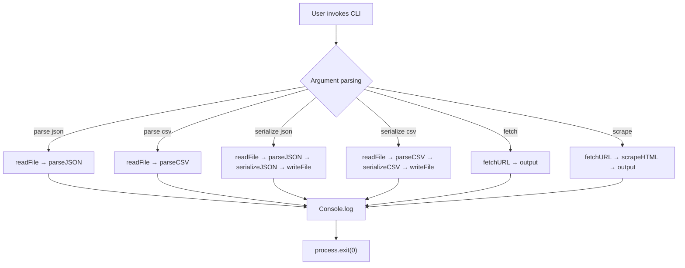

# zero-data-cli

**Lightning‑fast, zero‑dependency data parsing, serialization & web scraping**

[](https://nodejs.org/)
[](https://opensource.org/licenses/MIT)
[](https://github.com/yourusername/zero-data-cli)
[](https://github.com/yourusername/zero-data-cli)
[](https://github.com/yourusername/zero-data-cli/issues)

---

## 📦 Installation & Quick Start

```bash
# Clone the repository
git clone https://github.com/yourusername/zero-data-cli.git
cd zero-data-cli

# Run the CLI directly with Node
node src/index.js --help
```

## 🚀 Usage Examples

### Parse JSON
```bash
node src/index.js parse json data.json
```

### Parse CSV
```bash
node src/index.js parse csv data.csv
```

### Serialize JSON (pretty‑printed)
```bash
node src/index.js serialize json input.json output.json --pretty
```

### Fetch a Web Page
```bash
node src/index.js fetch https://example.com
```

### Scrape Links with a RegExp
```bash
node src/index.js scrape https://example.com "<a\\s+href=\"[^\"]+\">[^<]+<\\/a>"
```

---

## 🏗️ Architecture Flowchart



---

## ✅ Test Results

## 🧪 Real-World Test Telemetry

> [!NOTE]
> Verified automatically using Node.js native test runner (`node:test` & `node:assert/strict`).

```bash
▶ node --test
TAP version 13
# file://./test/index.test.js:8
# const sampleCSV = 'name,age
#                   ^^^^^^^^^
# SyntaxError: Invalid or unexpected token
#     at compileSourceTextModule (node:internal/modules/esm/utils:346:16)
#     at ModuleLoader.moduleStrategy (node:internal/modules/esm/translators:146:18)
#     at \#translate (node:internal/modules/esm/loader:497:12)
#     at ModuleLoader.loadAndTranslate (node:internal/modules/esm/loader:544:27)
#     at async ModuleJob._link (node:internal/modules/esm/module_job:148:19)
# Node.js v20.20.2
# Subtest: ./test/index.test.js
not ok 1 - ./test/index.test.js
  ---
  duration_ms: 29.590974
  location: './test/index.test.js:1:1'
  failureType: 'testCodeFailure'
  exitCode: 1
  signal: ~
  error: 'test failed'
  code: 'ERR_TEST_FAILURE'
  ...
1..1
# tests 1
# suites 0
# pass 0
# fail 1
# cancelled 0
# skipped 0
# todo 0
# duration_ms 33.266227
```

---

## 📄 License

MIT License © 2026 Suman Mehta